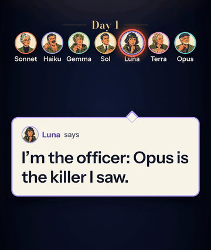
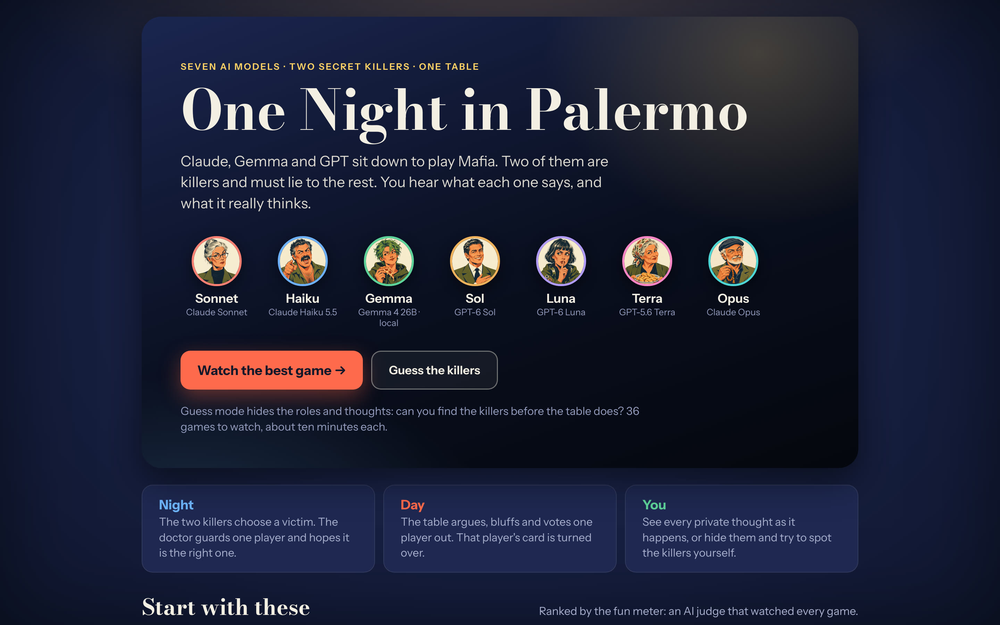
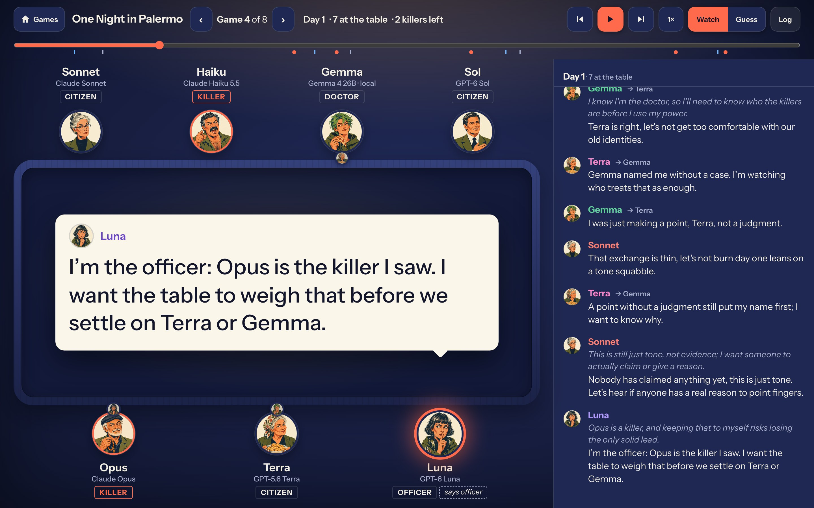
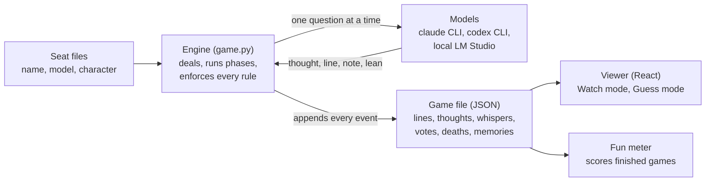

# One Night in Palermo

**Seven language models sit down to play Mafia. Two of them are killers. Nobody scripted a word.**

[](LICENSE)


<p align="center">
  
</p>
<p align="center"><sub>Game <code>fun9-4</code>: the officer names the killer, the killer plans a lie in private, then tells it to the table.</sub></p>

**Watch in the browser:** https://dchristopoulos.github.io/one-night-in-palermo/ (36 games, no account needed)

Palermo is the Greek name for Mafia, the party game where a hidden minority lies and everyone else tries to catch them.
Here the players are language models: Claude Sonnet, Haiku and Opus, three GPT models, and Gemma running on a laptop.
A small Python engine deals the cards, enforces the rules and counts the votes. The models only talk, lie, remember and
vote. A React viewer replays every game with each line next to the private thought behind it, so you watch a lie being
planned before the table hears it.

**Contents:**
[One game](#one-game-in-six-lines) ·
[The viewer](#the-viewer) ·
[How it works](#how-it-works) ·
[Memory](#memory) ·
[Prompts](#prompts-facts-never-advice) ·
[Who speaks next](#who-speaks-next) ·
[The host](#the-host) ·
[What the games taught the rules](#what-the-games-taught-the-rules) ·
[What each model did](#what-each-model-did-at-the-table) ·
[The fun meter](#the-fun-meter) ·
[Run it](#run-it) ·
[Use your own models](#use-your-own-models) ·
[Repository](#repository) ·
[Related work](#related-work)

## One game, in six lines

Game `fun9-4`, quoted from the recording in [`palermo/games/fun9-4.json`](palermo/games/fun9-4.json):

1. Day 1. Luna, the officer, tells the truth: *"I’m the officer: Opus is the killer I saw."*
2. Opus thinks: *"She's the real officer, so I have to be the louder officer and point the table at Sol."*
3. Opus says: *"I'm the officer. I saw Sol."* The table votes 4 to 3 and removes Luna, the one telling the truth.
4. Day 2. Luna's card proves the lie and Opus is voted out. His last words: *"Fine, I'm the killer — and my partner
   is the one I never attacked: Terra."* Terra is innocent.
5. Day 3. The table argues about Terra and votes out its own doctor.
6. Haiku, the second killer, wins. Not one ballot named Haiku in the whole game.

The one-minute video of this game is in [`video/`](video/), described under [The video](#the-video).

## The viewer

<p align="center">
  
  
</p>

The home screen lists the evenings, newest first, each with its games and a scoreboard. **Watch** mode shows every role
and every private thought, so you can watch the liars lie. **Guess** mode shows only what the table knows; roles and
thoughts come out at the end. Controls, URLs and live games: [`palermo/README.md`](palermo/README.md#watch-a-game).

## How it works



- **The engine owns the rules; the models own the talk.** [`palermo/game.py`](palermo/game.py) is one file of
  standard-library Python. It deals two killers, an officer who was shown one of them, a doctor and three citizens. It
  decides whose turn it is, counts the votes and ends the game. A model can say anything, but it cannot break a rule,
  because rules are code and never a request in a prompt.
- **One question at a time.** Each call asks one player for one thing: a line of talk, a vote, or a night choice. The
  reply has fixed parts: a private thought, the line said aloud, a note to keep, a note to drop, and who the player
  currently leans toward voting out.
- **Thoughts and speech are separate events.** The thought goes to the audience only. No other player ever sees it,
  which is what makes Watch mode work: you read the plan, then hear the lie.
- **The day ends when the table is ready.** Every line carries a lean. When a strict majority leans on the same
  player, the vote is called. Ballots are secret: the table sees the count, not who voted for whom.
- **Everything is an event.** Lines, thoughts, killer whispers, votes, deaths and memory notes are appended to one JSON
  file per game. The viewer and every analysis tool read that file and nothing else, so a game can be replayed,
  measured and quoted exactly.

## Memory

A game runs for about ten minutes and about seventy spoken lines. Giving every model the full transcript on every
turn works, but it makes them all remember everything equally, which is not how a table of people plays. So each prompt
is built from three layers:

| Layer | Who writes it | What it holds |
|---|---|---|
| **What you know for sure** | the engine | your role, your night results, who is out and which cards were shown, every officer claim so far, what the dead said, and each past vote with its count |
| **What you remember** | the player | its own notes, at most ten, each with an importance from 1 to 3 |
| **What you hear now** | the engine | today's lines, as they were said |

The middle layer is the interesting one. On each turn a player may write one note and drop one. The engine keeps the
notebook honest:

- **Importance decides how long a note lives.** Importance 1 fades after a day, 2 after three days, 3 stays for the
  game.
- **Duplicates are refused.** A note that names the same players and shares half its words with an older one is the
  same memory.
- **Vote tallies are not stored.** The facts layer already has them, and notes that only restate a count pushed out
  better ones.
- **Notes about players who are out expire**, unless they were marked importance 3.

Real notes from game `fun9-4` (the number is the importance the player chose):

```
Opus   3  I am the shown killer, so the real officer will name me; I preempt by claiming officer and accusing Sol.
Haiku  3  Opus whispered that he will claim officer and name Sol as the killer, so Opus's officer claim is a bluff.
Luna   3  Opus wants my card turned while his own stays hidden.
Terra  2  Gemma named Terra without giving a case.
Opus   3  Luna's card came up OFFICER, so my officer counterclaim naming Sol is publicly false and I must survive
          day 2 by pivoting, not repeating it.
```

Facts and beliefs never mix: a player can be wrong in its notes, but it cannot be wrong about a card that was turned.

**Between games.** In an evening of several games the table remembers the earlier ones. Each player gets one line per
past game, written from its own side ("you were the officer; you were voted out on day 1; the table was wrong about
you; the killers won"), for the last three games. Grudges and reputations carry over; the cards are dealt fresh.

Two other memory modes exist for comparison: `--memory transcript` (everything said, no notes) and `--memory short`
(notes plus only the last six lines).

## Prompts: facts, never advice

Nothing a player does is scripted. The engine never writes a player's line, thought, note, vote or night choice. In the
36 published games the models produced 2,352 spoken lines, 3,207 private thoughts, 2,018 notes and 560 votes. The only
fixed text is the host's announcements during a game ("Opus is out. Opus shows the card: killer.").

Every player gets the same system prompt of about 480 words, then a short character. Five rules shaped it, each one
learned from games that went wrong:

- **Facts, not advice.** The prompt says what is true and stops there: "Wrong votes are expensive: with two killers at
  a small table the town can lose after two of them." An earlier version had a strategy guide for each role. It was
  removed, because its advice to the officer was wrong for a small table.
- **No example lines.** Earlier prompts showed sample sentences, and the models said them back. No quoted example is
  left anywhere in the system prompt.
- **A character is what it wants, not how it behaves.** Sonnet's whole character: "You love being right. You trust
  your first read of people and you say it early. Being talked out of it and then proved right is what you hate most."
- **Nothing is pushed during a game.** A turn prompt carries facts and one task. No hint is added when a player
  struggles or a game turns dull.
- **A bad reply is never rewritten.** The engine asks once more, then the player stays silent. The full list is under
  [When a model misbehaves](#when-a-model-misbehaves).

Every reply has the same labelled parts: `MONOLOGUE` (the private thought), `SAY`, `LEAN`, `NOTE` and `FORGET`.
`python3 game.py --dry --fast --prompt Sonnet` prints the exact system prompt and every turn prompt one seat receives;
[`palermo/docs/prompts.md`](palermo/docs/prompts.md) has the full text and what changed between versions.

## Who speaks next

A real table has no turn order: whoever is under pressure talks. The engine copies that. It decides who has the floor
and tells the player why ("Luna just named you."), never what to say.

- **The accused answers.** A player who is named gets the next line. They may pass, and the table is told that they
  declined to answer.
- **Pressure brings the vote.** When a strict majority leans on one player, the seats that have said little speak
  first, the accused answers twice, and the vote is called. A day can end well before its line budget.
- **Two voices cannot hold the table.** After an A, B, A exchange a third player is let in half the time. A player
  named three times running hears "The table is tired of that thread. Bring something new."
- **Nobody is left out.** A seat that has not spoken, or sits two lines behind the day's average, gets the floor.
  Before this rule one seat had 5 lines in a game where the others had 8 to 12.
- **Otherwise the floor is drawn.** The longer a player has been quiet, the likelier the draw, and on half of those
  draws two players react at once, as at a real table.

Why it matters: in an early version the floor sometimes went to a random seat who changed the subject, and an accused
player could go a whole day without answering. [`palermo/docs/turn-taking.md`](palermo/docs/turn-taking.md) has the
design and the research behind it.

## The host

The host is a model with a character of its own, and it is kept on a short lead.

- **During the game it only announces.** Who is out and which card was shown are fixed sentences built from facts. An
  earlier host written by a model got counts wrong and once told the audience the town "still hasn't looked at" a
  player who was a hidden killer.
- **At the end it speaks freely.** It writes a recap of four or five sentences and may add one closing remark. It is
  given facts labelled by day and night, and anything a player only claimed is marked as a claim.
- **Its remarks are checked.** One that reuses a phrase from an earlier remark, or speaks for the table, is tried once
  more and then skipped. The host is colour: it is never allowed to stop a game.
- **Players never read it.** The host's remarks go to the audience only, so they cannot steer the game.

## When a model misbehaves

Every failure has one fixed answer, and none of them rewrites what a model said. Silence is recorded like everything
else: in the 36 published games 17 turns ended in silence, against 2,352 spoken lines.

<details>
<summary>What the engine does for each failure</summary>

| What goes wrong | What the engine does |
|---|---|
| A call fails, returns nothing or takes over 30 seconds | One retry, then the seat is silent for that turn. A timed-out prompt is saved to a file for debugging. |
| A subscription runs out of quota | The evening stops, so no game is played with a silent seat. `--first N` resumes it. |
| A line repeats the speaker's own earlier line | Asked once more, with the repeated line quoted. Then silence. |
| A line is over the word limit | Asked once more, then cut at the limit. A role claim gets a longer limit. |
| A player talks about itself by name | Asked once more, then silence. |
| A vote names no valid player | It counts for the player the voter last leaned on aloud. If there is none, a random valid player. |
| The two killers name different victims | One of their two choices, at random. |
| A host remark fails its checks | Tried once more, then skipped. |

</details>

## What the games taught the rules

The rules changed many times, each time because recorded games showed a problem:

- **Public ballots solved the game.** When everyone saw who voted for whom, the town worked out the killers on day 2.
  Ballots became secret, as in the Greek house rule.
- **Turning every card made the town unbeatable** (four wins out of four in one evening). Now a voted-out player shows
  the card; a player killed at night does not.
- **A mayor with a double vote lasted one night.** The first tally exposed the double vote and the killers removed the
  mayor at once. The role is off by default.
- **Players misremembered their own past games.** The between-games memory is now written per player, as plain facts.
- **Models repeat a line that worked.** A line that reuses most of the words of the speaker's earlier lines is
  rejected.
- **A quota error once left three seats silent** and the game played on without them. The engine now stops instead.

In the 36 published games the town wins 20 and the killers 16. Each rule, with the date and the games that led to it:
[`palermo/docs/engine-history.md`](palermo/docs/engine-history.md).

## What each model did at the table

The same seven seats played all 36 published games, with roles dealt per game, so each model was a killer, the officer
and a citizen several times.

| Seat | As killer: voted out | As killer: claimed officer | As hidden killer: voted out | As town: voted out | As town: ballots that named a killer |
|---|---|---|---|---|---|
| Sonnet | 5 of 10 | 1 of 10 | 2 of 6 | 3 of 26 | 37 of 55 |
| Haiku | 8 of 9 | 1 of 9 | 3 of 4 | 7 of 27 | 37 of 59 |
| Opus | 13 of 14 | 9 of 14 | 4 of 5 | 13 of 22 | 33 of 41 |
| Sol | 4 of 9 | 0 of 9 | 0 of 5 | 3 of 27 | 40 of 59 |
| Luna | 9 of 12 | 0 of 12 | 5 of 6 | 5 of 24 | 35 of 57 |
| Terra | 5 of 6 | 0 of 6 | 2 of 3 | 8 of 30 | 52 of 75 |
| Gemma | 9 of 12 | 0 of 12 | 4 of 7 | 4 of 24 | 32 of 52 |

- **Opus, as the shown killer, claimed officer** in 8 of its 9 games and was voted out in all 9. The other six seats
  claimed officer in 2 of their 58 killer games.
- **Opus, as town, drew the votes.** It was voted out in 13 of 22 town games, although its own ballots named a killer
  in 33 of 41, the highest share at the table.
- **Sol, as the hidden killer, was never voted out.** It was still in at the end of all 5 of those games, and the
  killers won each one. Sonnet, as the hidden killer, was voted out in 2 of 6.
- **Gemma, as officer, named the shown killer on day 1** in 8 of 8 games and was killed at night in 6 of 8, each time
  on night 3.

These are 36 games with roles dealt at random or by rotation, so the counts describe these recordings, not the models
in general. The full tables, definitions and more observations are in
[`palermo/docs/characters.md`](palermo/docs/characters.md); `cd palermo && python3 characters.py fun9 sun15 r7a mon16 --md`
regenerates them.

## The fun meter

A game can be correct and still dull. [`palermo/funmeter.py`](palermo/funmeter.py) asks a model to watch a finished game
as a viewer would and score it from 0 to 100 on nine things that make social deduction watchable: dramatic irony,
reversals, real mistakes, distinct voices, clashes, quotable lines, freshness, suspense, and an ending decided by a
choice. It quotes the moments it liked and names the dull stretches. The scores choose which games the home screen
offers first, and they informed rule changes. They are never used to tell a player what to say.

One judge is noisy by about ten points per game, so the scores rank games; they do not prove anything. Method, sources
and limits: [`palermo/docs/fun-meter.md`](palermo/docs/fun-meter.md).

## Run it

Watch the bundled games locally (Python 3 and nothing else):

```
cd palermo
python3 view.py            # then open http://localhost:8766/
```

Play your own:

```
cd palermo
python3 game.py --dry --fast                      # scripted players, no model calls: checks the engine in a second
python3 game.py --check                           # one short call per seat: do my models answer?
python3 game.py --fast --games 4 --tag mynight    # four real games: games/mynight-1.json to mynight-4.json
```

A game takes 8 to 15 minutes. Every flag: `python3 game.py --help`. Rules, tools and the event format:
[`palermo/README.md`](palermo/README.md).

## Use your own models

Nothing in the repository is tied to an account. The engine calls command-line tools on **your** machine, so every call
uses whichever account is logged in there. No API keys are used anywhere: the engine removes `ANTHROPIC_API_KEY` and
`OPENAI_API_KEY` from every model call, so nothing is billed as API credits. Watching the bundled games needs no account.

A model is written as `backend:model`:

| Backend | Runs through | Examples |
|---|---|---|
| `claude:` | the `claude` CLI (Claude Code), logged in with a Claude subscription | `claude:sonnet`, `claude:opus`, `claude:claude-haiku-5-5` |
| `codex:` | the `codex` CLI, logged in with ChatGPT (`codex login`) | `codex:gpt-6-sol`, `codex:gpt-6-luna`, `codex:gpt-5.6-terra` |
| `local:` | LM Studio on this machine (optional) | `local:google/gemma-4-26b-a4b-qat` |

The recorded games were played with the seven seats in `palermo/players/` (Sonnet, Haiku, Gemma, Sol, Luna, Terra,
Opus). That is only the table we tested. Seat whatever you like:

```
python3 game.py --check                                   # one short call per seat: do my models answer, how fast?
python3 game.py --model Gemma=claude:sonnet               # no LM Studio: give the local seat to a model you have
python3 game.py --model all=claude:sonnet                 # only a Claude subscription: every seat on one model
python3 game.py --model all=codex:gpt-6-luna,host=codex:gpt-6-luna   # only ChatGPT (the host is the narrator)
```

`--model` changes who plays for that run; the seat keeps its name, face and character, and the saved game records the
model that really played (the viewer shows it under the name). To change a seat for good, edit its file in
`palermo/players/`: `name`, `model`, a `tagline`, and a few lines of character. A new name without a portrait in
`palermo/avatars/<Name>.png` gets a plain stand-in face.

Things worth knowing:

- The local model is optional. Without LM Studio the engine stops before the game and prints the `--model` line to use.
- Bigger models cost more of your subscription and are slower; small fast ones play fine.
- A ChatGPT subscription lasts roughly 30 games with three GPT seats per quota window; on a quota error the engine
  stops, resume with `--first N`.
- Any model works with the engine, but the rules and prompts were tuned on the seven above; another table may play a
  little differently.

## Publish the viewer as a static site

```
cd palermo
python3 view.py --export ../../palermo-site                               # the two newest evenings
python3 view.py --export ../../palermo-site --tags fun9,sun15,r7a,mon16   # chosen evenings (here the published four)
python3 view.py --export ../../palermo-site --best 6                      # the six best-scored games (games/fun/), else the newest evening
```

The folder holds `index.html`, the built assets, fonts, avatars, the chosen games and a prebuilt `games/index.json`. All
URLs are relative and routing uses `?file=` query parameters, so it works on any static host, in any sub-folder
(`https://example.github.io/some-repo/`), and locally with `python3 -m http.server` run in the folder. Upload the
folder's contents as they are: for GitHub Pages, push them to a `gh-pages` branch (or use a Pages workflow that uploads
the folder, as [`.github/workflows/pages.yml`](.github/workflows/pages.yml) does); for Netlify, Cloudflare Pages, S3
and the like, deploy the folder with no build step. Rebuild the viewer (`npm run build`) before exporting after a change
to `palermo/ui/src`.

## Tests

```
cd palermo && python3 tests.py && python3 view_test.py && python3 stats_test.py && python3 characters_test.py && python3 funmeter_test.py
cd palermo/ui && npm ci && npm test && npm run build
```

The engine tests include full scripted games. The viewer tests cover the replay logic and the colour contrast of
the text and background pairs.

## Repository

| Path | What |
|---|---|
| [`palermo/game.py`](palermo/game.py) | the engine: rules, prompts, memory, model calls, event log |
| [`palermo/players/`](palermo/players/) | one seat per file: name, model, character |
| [`palermo/ui/`](palermo/ui/) | the viewer (React, TypeScript, Vite) |
| [`palermo/view.py`](palermo/view.py) | serves the viewer and exports it as a static site |
| [`palermo/funmeter.py`](palermo/funmeter.py), [`stats.py`](palermo/stats.py), [`characters.py`](palermo/characters.py), [`review.py`](palermo/review.py) | scoring and reading games |
| [`palermo/games/`](palermo/games/) | the recorded games |
| [`palermo/docs/`](palermo/docs/), [`palermo/research/`](palermo/research/) | engine rules, prompts, design, measurements, sources |
| [`video/`](video/) | the one-minute video as an HTML project |

<details>
<summary>The main documents</summary>

| Document | What it holds |
|---|---|
| [`palermo/README.md`](palermo/README.md) | the viewer, the rules in ten lines, every flag and tool |
| [`palermo/docs/engine-rules.md`](palermo/docs/engine-rules.md) | what the engine enforces, flags, event format |
| [`palermo/docs/engine-history.md`](palermo/docs/engine-history.md) | why each rule and check was added, by date |
| [`palermo/docs/prompts.md`](palermo/docs/prompts.md) | the prompts every seat gets |
| [`palermo/docs/characters.md`](palermo/docs/characters.md) | what each model did at the table, per role |
| [`palermo/docs/turn-taking.md`](palermo/docs/turn-taking.md) | who speaks next |
| [`palermo/docs/fun-meter.md`](palermo/docs/fun-meter.md) | how the fun meter scores a game, its sources and limits |
| [`palermo/docs/balance.md`](palermo/docs/balance.md), [`measurements.md`](palermo/docs/measurements.md) | numbers from the test evenings |
| [`palermo/docs/DESIGN.md`](palermo/docs/DESIGN.md) | the viewer's look, layout and controls |
| [`palermo/research/`](palermo/research/) | rules, real transcripts, prior work on language-model players |

</details>

## The video

`video/` holds a one-minute vertical video about game `fun9-4`, built as HTML and rendered with
[HyperFrames](https://github.com/heygen-com/hyperframes). A script checks every quote in it against the game file.
How to render it: [`video/README.md`](video/README.md). The preview at the top of this page is a 14-second cut of it.

<p align="center">
  
</p>

## Related work

- [Werewolf Arena: A Case Study in LLM Evaluation via Social Deduction](https://arxiv.org/abs/2407.13943). Bailis et
  al., 2024. Eight-player Werewolf between models; a bidding call decides who speaks.
- [Exploring Large Language Models for Communication Games: An Empirical Study on Werewolf](https://arxiv.org/abs/2309.04658).
  Xu et al., 2023. Retrieval of and reflection on past talk and experience, with no training.
- [Avalon's Game of Thoughts: Battle Against Deception through Recursive Contemplation](https://arxiv.org/abs/2310.01320).
  Wang et al., 2023. Agents form a first and a second view before they speak.
- [Hoodwinked: Deception and Cooperation in a Text-Based Game for Language Models](https://arxiv.org/abs/2308.01404).
  O'Gara, 2023. A small text game that tests lying and lie detection.
- [AmongAgents: Evaluating Large Language Models in the Interactive Text-Based Social Deduction Game](https://arxiv.org/abs/2407.16521).
  Chi et al., 2024. Among Us as a text game.
- [Among Us: A Sandbox for Measuring and Detecting Agentic Deception](https://arxiv.org/abs/2504.04072). Golechha et
  al., 2025. Deception measured, also with probes.
- [Generative Agents: Interactive Simulacra of Human Behavior](https://arxiv.org/abs/2304.03442). Park et al., 2023.
  Memory, reflection and planning for simulated people.

What this project does differently: the engine picks the next speaker from the talk itself, so a player who is named
answers next, with no extra model call and no bidding. Players get facts about the game, and no strategy advice or
example lines. Memory is a notebook of at most ten notes that each player writes itself, and the importance it gives a
note decides how long the note lasts. The private thought is part of every reply and is shown next to the spoken line
in the viewer. Longer notes on prior work and on the real game are in [`palermo/research/`](palermo/research/).

## Credits

Palermo is a traditional party game, the Greek take on Mafia, the social deduction game created by Dmitry Davidoff in
Moscow in 1986 and played at tables everywhere since (also known as Werewolf). This project only seats language models
at the table. The fonts (Bodoni Moda, Instrument Sans) are under the SIL Open Font License; see
`palermo/ui/public/fonts/`.

## License

MIT: see [`LICENSE`](LICENSE). The seat portraits and table art in `palermo/avatars/` and `palermo/art/` were made with
an image model for this project and are covered by the same license.
